# AI Chronic Disease Risk Screener

A web app that screens for five common conditions in about 5 minutes: **hypertension, type 2 diabetes, chronic kidney disease, anemia and diabetic retinopathy**. It uses a short lifestyle questionnaire, a photo of your fingernails and a retina photo. No blood test is needed.

Every model is trained on public medical datasets, tested on data it never saw, and documented with a model card.

> ⚠️ **Medical disclaimer:** this is an educational and research project, not a medical device. Results are screening estimates, not a diagnosis. Please consult a doctor about your health.

<p align="center">
  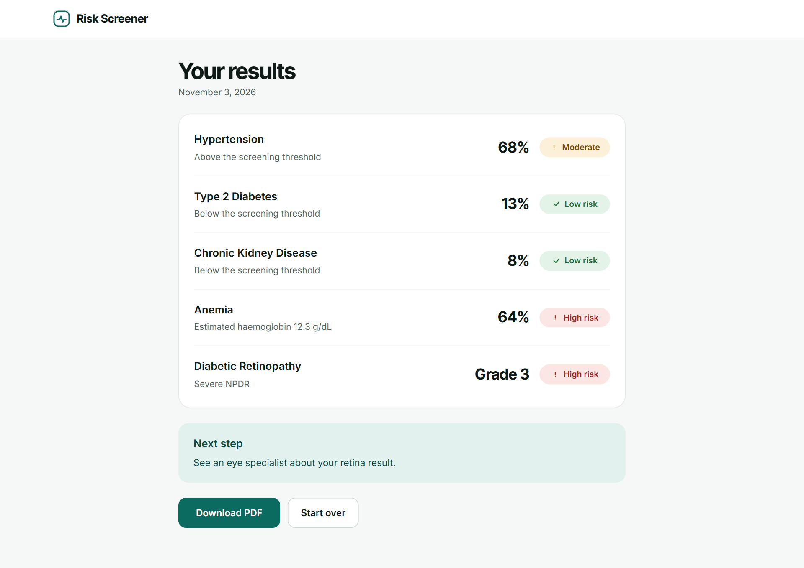
</p>

## What it checks

| Condition | Input | Model | Trained on | Result on held-out data |
|---|---|---|---|---|
| Hypertension | Questionnaire | XGBoost, calibrated | 17,296 US adults (NHANES 2011–2018) | AUROC **0.789** on a later survey (2021–2023) |
| Type 2 diabetes | Questionnaire | XGBoost, calibrated | NHANES 2011–2018 | AUROC **0.806** on 2021–2023 |
| Chronic kidney disease | Questionnaire | LightGBM, calibrated | NHANES 2011–2018 | AUROC **0.786** on 2021–2023 |
| Anemia | Fingernail photo | Nail detector + EfficientNet-B0 embeddings + ridge regression | 250 adults with measured haemoglobin | AUROC **0.846** (cross-validated) |
| Diabetic retinopathy | Retina (fundus) photo | EfficientNet-B0, 5-model ensemble | 2,000 graded fundus images (DeepDRiD) | AUROC **0.972** for referable DR (held-out test) |

AUROC measures how well a model ranks people who have the condition above people who don't: 0.5 is a coin flip and 1.0 is perfect.

## The app

The app has four simple screens: start, three short question steps, two photo uploads, and the results.

<table>
  <tr>
    <td width="50%">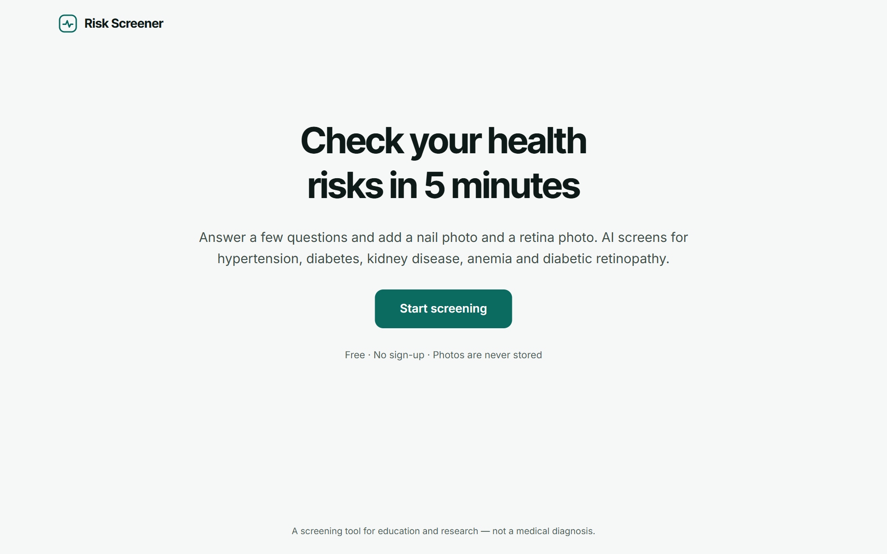</td>
    <td width="50%">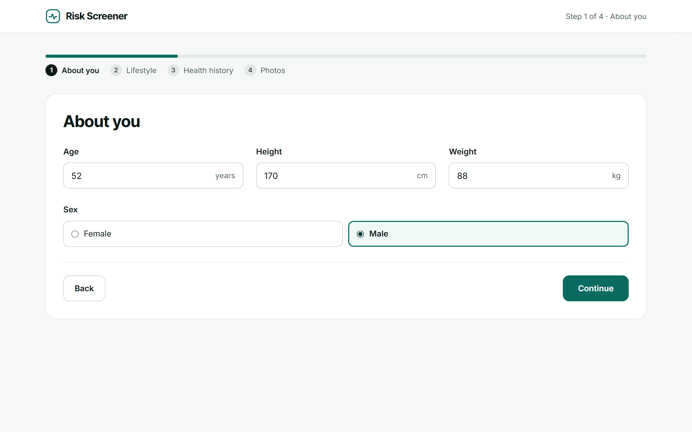</td>
  </tr>
  <tr>
    <td><b>1. Start.</b> What the screening covers and how long it takes.</td>
    <td><b>2. About you.</b> Age, sex, height and weight (BMI is calculated automatically).</td>
  </tr>
  <tr>
    <td>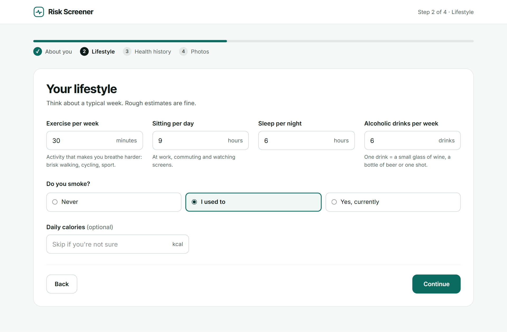</td>
    <td>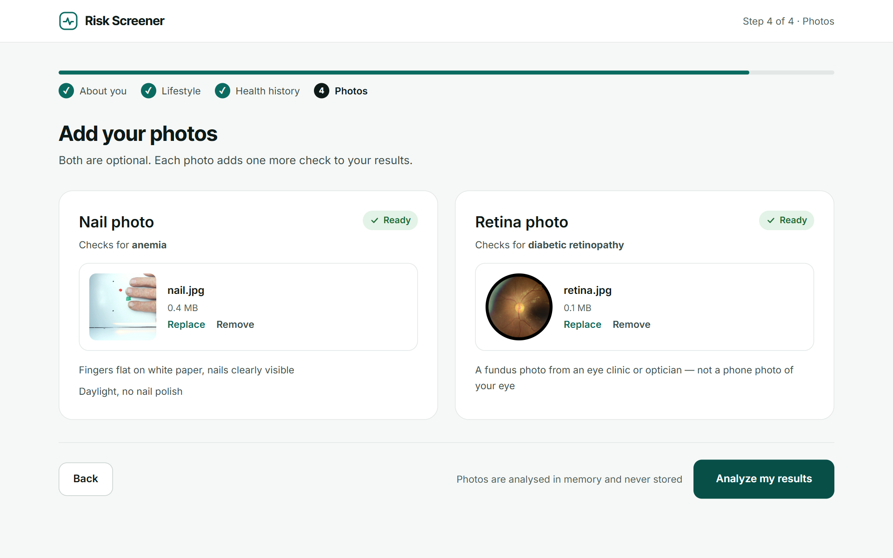</td>
  </tr>
  <tr>
    <td><b>3. Lifestyle and health history.</b> Exercise, sitting, sleep, alcohol, smoking, and any earlier diagnoses. Every field is validated with a plain-language hint.</td>
    <td><b>4. Photos.</b> Two plain uploads, both optional. The nails are found in the photo automatically, so there is nothing to mark or crop.</td>
  </tr>
</table>

**Results** show one row per condition with a risk percentage and a clear label (low / moderate / high), plus the single most important next step. Results can be saved as a PDF, and the layout works on phones:

<p align="center">
  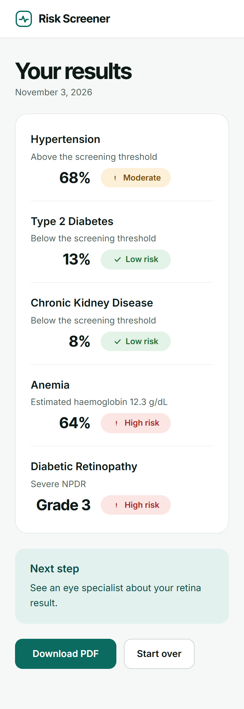
</p>

Photos are processed in memory and never stored.

## How it works

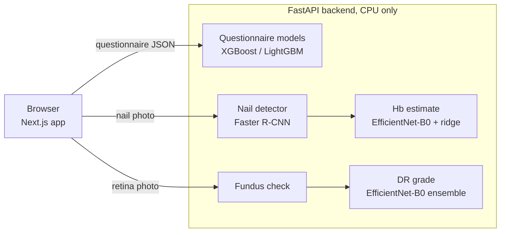

- **Frontend:** Next.js 16, React 19, TypeScript and Tailwind CSS.
- **Backend:** FastAPI. The image models run as **ONNX** files on CPU, so the API needs no PyTorch or GPU. Each prediction takes well under a second.
- **Training:** PyTorch, timm, scikit-learn, XGBoost, LightGBM and Optuna, plus reproducible scripts for every model.

## Models and results

Everything is evaluated the same honest way:
- **Truly unseen test data:** a later survey (2021–2023), or patients the model never saw.
- **No leakage:** cross-validation folds are grouped by person or photo session.
- **Confidence intervals** for every reported number.
- **Fixed thresholds:** cut-offs are chosen on training data only.

Each model has a full card in [docs/models/](docs/models/).

### 1. Questionnaire models: hypertension, diabetes, kidney disease

**Data.** The [NHANES](https://www.cdc.gov/nchs/nhanes/) survey of the US CDC includes interviews, physical exams and lab tests for 28,469 adults ([dataset summary](docs/data/nhanes_dataset.md)). The labels come from **measurements, not self-report:**
- **Hypertension:** measured blood pressure ≥130/80 mmHg or on medication (2017 ACC/AHA guideline).
- **Diabetes:** HbA1c ≥6.5%, diagnosed, or treated (ADA).
- **Kidney disease:** eGFR <60 using the CKD-EPI 2021 equation, or urine albumin-to-creatinine ratio ≥30 mg/g (KDIGO).

So the models also catch people who don't know they have the condition.

**Training.**
- **Model choice:** Logistic Regression, XGBoost and LightGBM were compared with 5-fold cross-validation, with hyperparameters tuned by Optuna.
- **Calibration:** the winner's probabilities are calibrated with isotonic regression, so "30% risk" means about 30 in 100 similar people have the condition.
- **Threshold:** the screening threshold is set to catch at least 80% of cases.

**Testing.** Models were trained on the 2011–2018 surveys and tested on **2021–2023**, people surveyed years later. This is a stricter test than a random split and shows how the model holds up over time.

| Condition | AUROC internal test | AUROC temporal test (2021–2023) | Sensitivity / specificity (temporal) |
|---|---|---|---|
| [Hypertension](docs/models/hypertension.md) | 0.822 (0.809–0.835) | 0.789 (0.779–0.801) | 87% / 56% |
| [Type 2 diabetes](docs/models/diabetes.md) | 0.812 (0.797–0.827) | 0.806 (0.793–0.819) | 82% / 63% |
| [Chronic kidney disease](docs/models/ckd.md) | 0.789 (0.771–0.808) | 0.786 (0.771–0.802) | 84% / 54% |

<table>
  <tr>
    <td width="50%">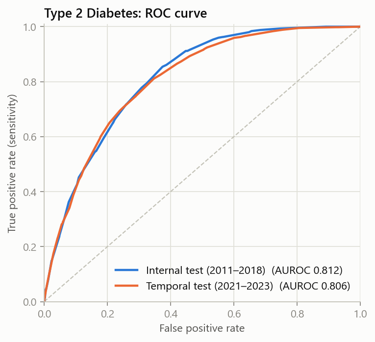</td>
    <td width="50%">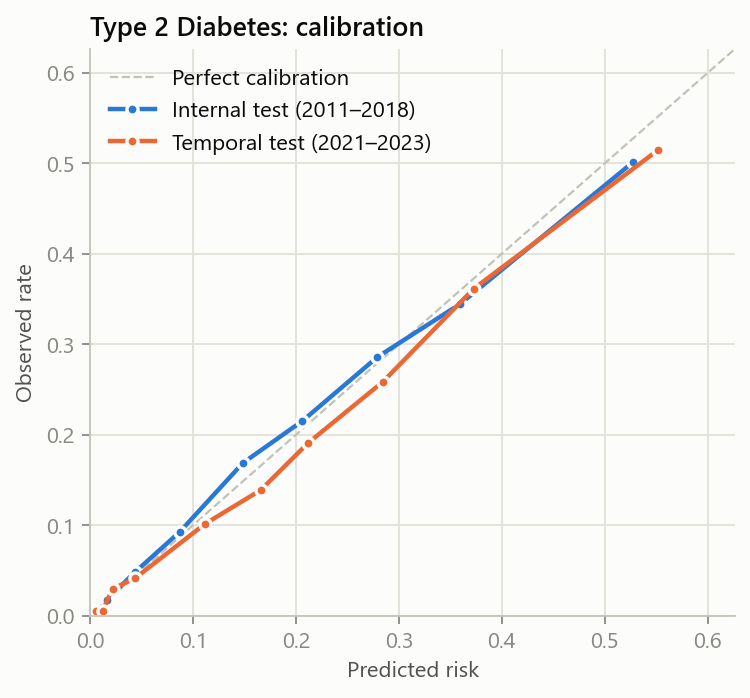</td>
  </tr>
  <tr>
    <td><b>ROC curve (diabetes).</b> Each line trades off catching more cases (up) against more false alarms (right). The closer a curve hugs the top-left corner, the better. The internal and temporal curves almost overlap: performance holds on people surveyed years later.</td>
    <td><b>Calibration (diabetes).</b> Predicted risk (x-axis) against how often the condition actually occurred (y-axis). Points on the dashed diagonal mean the percentages can be taken at face value.</td>
  </tr>
  <tr>
    <td>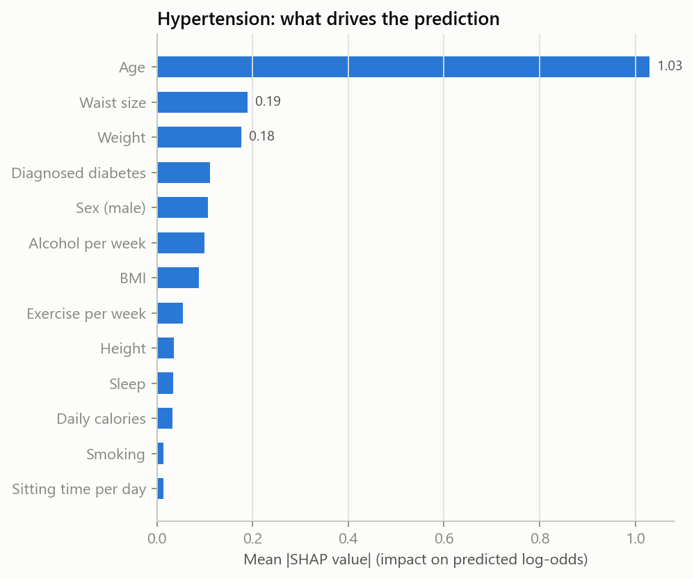</td>
    <td>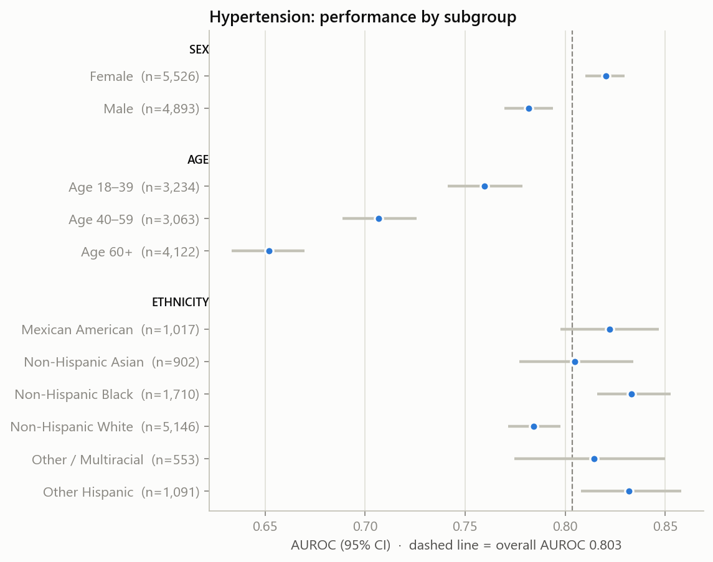</td>
  </tr>
  <tr>
    <td><b>What drives the prediction (hypertension).</b> Average impact of each input on the risk, measured with SHAP. Age matters by far the most, followed by waist size and weight, which matches what is known medically.</td>
    <td><b>Fairness audit (hypertension).</b> AUROC with 95% confidence interval for each sex, age band and ethnicity group. Ethnicity is <i>not</i> a model input; it is used only to check that the model works similarly well for everyone.</td>
  </tr>
</table>

Each condition's model card has all four charts, plus a model comparison chart.

### 2. Anemia from a fingernail photo

Pale nail beds are a classic sign of anemia (low haemoglobin, Hb). The model estimates Hb from the colour of the nails compared with the skin next to them. The skin acts as a built-in reference for lighting and camera.

**Data.** [Yakimov et al., *Scientific Data* 2024](https://doi.org/10.6084/m9.figshare.c.6760179): 250 adults with Hb measured from a blood sample, photographed in 20 sessions.

**How the approach was chosen.** Ten approaches were compared under the same rules: 5-fold cross-validation grouped by photo session, repeated 5 times. They ranged from hand-crafted colour features to three different pretrained networks to full fine-tuning.
- **Winner:** frozen **EfficientNet-B0** embeddings of the nail and skin, followed by ridge regression.
- **Fine-tuning lost:** with only 250 people, it overfit.

**Automatic nail finding.** Users upload a plain photo, so a **Faster R-CNN** detector was trained on the dataset's 750 nail and 750 skin boxes.
- **Accuracy:** it finds **99.7%** of nails and finds something in every photo.
- **No loss from automation:** anemia AUROC is **0.846** with its boxes, against 0.840 with hand-drawn boxes.
- **Why not MediaPipe Hands:** it was tried first and found a hand in only 13 of 250 photos.

| Metric (cross-validated, 250 people) | Result |
|---|---|
| AUROC, anemia (Hb < 12 g/dL), automatically detected nails | **0.846** |
| AUROC, moderate anemia (Hb < 11 g/dL) | 0.893 |
| Mean Hb error with detected nails | 1.5 g/dL |

<table>
  <tr>
    <td width="50%">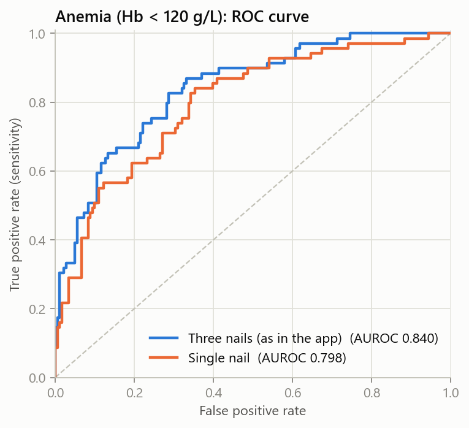</td>
    <td width="50%">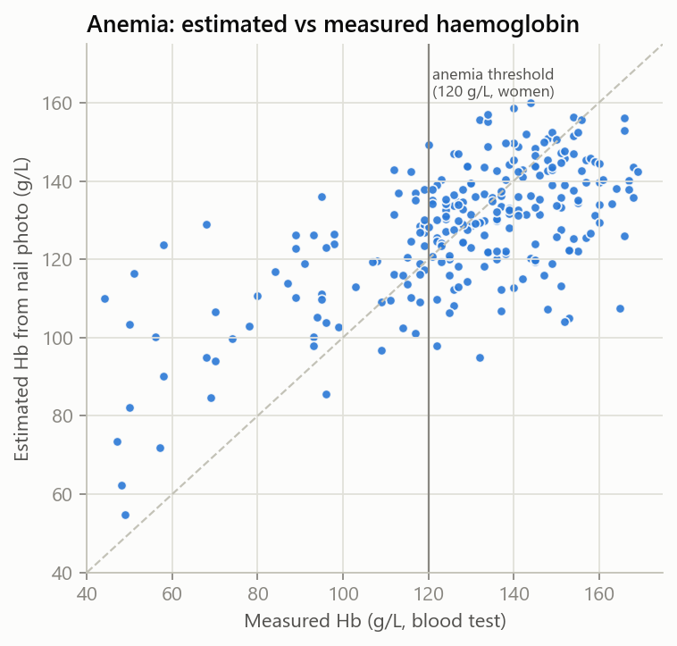</td>
  </tr>
  <tr>
    <td><b>ROC curve.</b> How well the estimated Hb separates people with and without anemia. The app uses three nails per photo, which is clearly better than one.</td>
    <td><b>Estimated vs measured Hb.</b> Each dot is a person, and the diagonal is a perfect estimate. The estimate follows the trend but is noisy, which is why the app reports a <i>probability</i> of anemia, not a lab value.</td>
  </tr>
</table>

[Full anemia model card →](docs/models/anemia.md)

### 3. Diabetic retinopathy from a retina photo

Diabetic retinopathy (DR) is damage to the retina's blood vessels caused by diabetes, and a leading cause of preventable blindness. Ophthalmologists grade it from 0 (none) to 4 (proliferative). Grade 2 or worse is "referable": the patient should see an eye specialist.

**Data.** [DeepDRiD](https://github.com/deepdrdoc/DeepDRiD): 2,000 fundus images from 500 patients, graded by ophthalmologists. The official split keeps 400 images from 100 different patients as a test set that was never touched during training.

**Model.**
- **Network:** EfficientNet-B0 fine-tuned to predict the grade on 384 × 384 px images.
- **Ensemble:** five cross-validation models (grouped by patient) are averaged into one ONNX file.
- **Test-time augmentation:** each photo is also scored flipped, and the results are averaged.
- **Post-processing:** grade cut-points and probabilities are tuned on cross-validation predictions only.

| Metric | Cross-validation (1,600 images) | Held-out test (400 images) |
|---|---|---|
| Quadratic weighted kappa (0 to 1) | 0.785 | **0.852** (0.796–0.895) |
| AUROC, referable DR | 0.936 | **0.972** (0.947–0.988) |
| Sensitivity / specificity, referable DR | 90% / 82% | **92% / 89%** |

Quadratic weighted kappa measures agreement with the doctors' grade, with bigger mistakes penalised more. Above 0.8 is considered strong agreement.

<table>
  <tr>
    <td width="50%">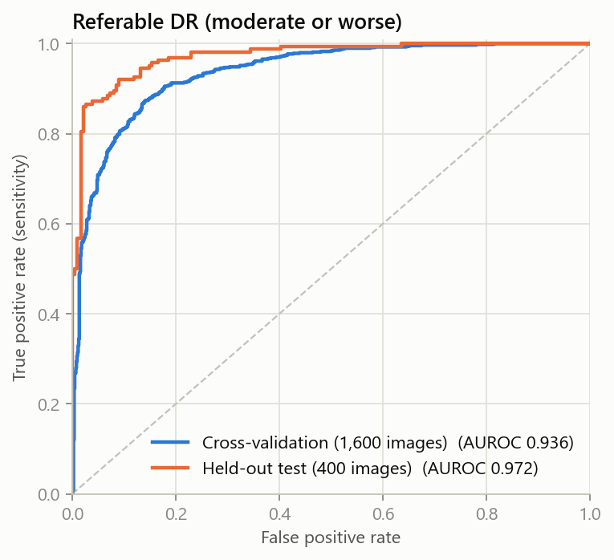</td>
    <td width="50%">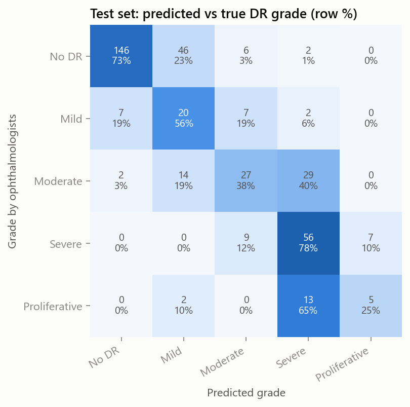</td>
  </tr>
  <tr>
    <td><b>ROC curve, referable DR.</b> At the chosen threshold, the model catches 92% of patients who need an eye specialist.</td>
    <td><b>Confusion matrix (test set).</b> Rows are the doctors' grade and columns are the model's. Most errors land one grade away. The model rarely mixes up the extremes: no Proliferative case is called No DR.</td>
  </tr>
</table>

<p align="center">
  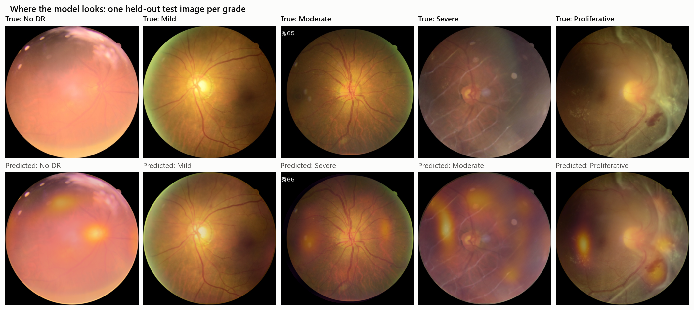
</p>

**Where the model looks.** These are class-activation maps on one test image per grade. Bright areas are the regions that pushed the predicted grade up. On diseased eyes they fall on lesion areas inside the retina, such as haemorrhages and exudates, not on the image border or camera artefacts. This is a sanity check that the model reacts to the eye itself.

[Full retina model card →](docs/models/retina.md)

## Run it locally

You need Python 3.11 and Node 20+. The trained models are already in [backend/models/](backend/models/), so no training is needed to run the app.

**Backend**, from the repository root:

```bash
python -m pip install -r backend/requirements.txt
uvicorn backend.app.main:app --reload
```

The API runs at http://127.0.0.1:8000, and the interactive docs are at http://127.0.0.1:8000/docs.

**Frontend**, in a second terminal:

```bash
cd frontend
cp .env.example .env.local    # points the app at http://127.0.0.1:8000
npm install
npm run dev
```

Open http://localhost:3000. On the photo step, **"use a sample photo"** lets you try both image checks without your own photos.

**Tests:**

```bash
python -m pytest backend/tests ml/tests
```

There are 54 tests, covering:
- the API, input validation and image handling;
- the eGFR and label definitions;
- model loading and preprocessing.

## Reproduce the models

Install the training requirements with `python -m pip install -r ml/requirements.txt`. A CUDA GPU is recommended for the image models.

| Step | Command |
|---|---|
| Download NHANES and build the dataset | `python -m ml.nhanes.download` then `python -m ml.nhanes.build_dataset` |
| Train the questionnaire models, charts and model cards | `python -m ml.tabular.train` |
| Compare anemia approaches (downloads the data) | `python -m ml.anemia.compare` |
| Train and export the anemia model | `python -m ml.anemia.train` |
| Train, evaluate and export the nail detector | `python -m ml.anemia.detector` |
| Train the retinopathy model (needs [DeepDRiD](https://github.com/deepdrdoc/DeepDRiD) in `RETINA_DATA_DIR`) | `python -m ml.retina.train` |
| Export and verify the retinopathy model, then make its charts | `python -m ml.retina.export` then `python -m ml.retina.report` |

Each export checks that the ONNX model gives the same output as the PyTorch model. It also checks that the API's own code path reproduces the reported test predictions.

## Repository structure

```
backend/
  app/            FastAPI app: routes, schemas, image handling, one module per model
  models/         exported models (joblib + ONNX) used by the API
  tests/          API tests
frontend/
  app/            pages: home, screening steps, results
  components/     form fields, upload box, header
  lib/            API client and result helpers
ml/
  nhanes/         NHANES download, cleaning and labels
  tabular/        questionnaire model training, metrics and charts
  anemia/         nail-photo dataset, approach comparison, Hb model, nail detector
  retina/         DeepDRiD data, training, ONNX export, charts
  tests/          tests for labels and preprocessing
docs/
  models/         model cards with charts for every model
  data/           NHANES dataset summary
  screenshots/    app screenshots used in this README
```

## Limitations

- **Population:** the questionnaire models learn from US adults. Risk in other populations may differ.
- **Anemia data is small:** 250 people, photographed under controlled lighting. Phone photos at home will usually be less accurate, and skin tone was not recorded in the dataset.
- **Retina photos:** the retina model needs a fundus camera photo from an eye clinic or optician, not a phone photo of the eye. Its data comes from a single source and has not been validated externally.
- **Not a diagnosis:** none of the models are a substitute for a blood test, a blood-pressure measurement or an eye exam.

## Data sources and licences

- **NHANES:** US CDC / National Center for Health Statistics, public domain.
- **Fingernail photos and haemoglobin:** Yakimov et al., 2024, CC0.
- **DeepDRiD:** Liu et al., *Patterns* 2022, CC BY-SA 4.0.
