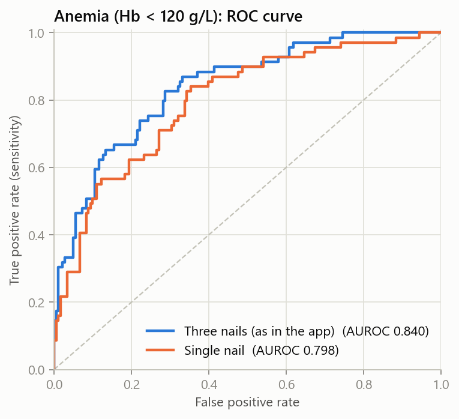
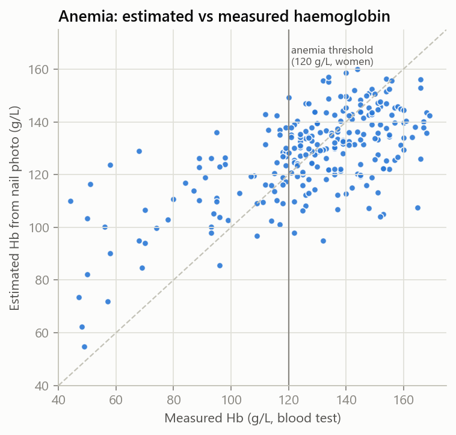

# Model card: Anemia screening (fingernail photo)

**Estimates:** blood haemoglobin (Hb) from a photo of a fingernail and nearby skin, then the probability of anemia using WHO thresholds (Hb < 120 g/L for women, < 130 g/L for men).

**Training data:** [Yakimov et al., *Scientific Data* 2024](https://doi.org/10.6084/m9.figshare.c.6760179), 250 adults aged 18–95 with Hb measured from venous blood, photographed in 20 sessions. License CC0.

**Model:** pretrained EfficientNet-B0 (ImageNet) image embeddings of the nail and of the adjacent skin, followed by ridge regression. The skin embedding acts as a lighting and camera reference. The backbone runs as ONNX in the API.

## How the approach was chosen

Every approach was scored with 5-fold cross-validation **grouped by photo session** (photos from one session share lighting and never appear in both training and test folds), repeated over 5 shuffles.

| Approach | Hb error (MAE, g/L) | AUROC, Hb < 120 g/L |
|---|---|---|
| Baseline (predict mean Hb) | 19.9 | 0.447 ± 0.020 |
| Colour features: nail | 16.8 | 0.800 ± 0.002 |
| Colour features: nail + skin reference | 16.6 | 0.803 ± 0.005 |
| EfficientNet-B0 embedding: nail | 15.5 | 0.816 ± 0.006 |
| EfficientNet-B0 embedding: nail + skin | 15.5 | 0.828 ± 0.009 |
| ConvNeXt-Tiny embedding: nail | 15.7 | 0.823 ± 0.007 |
| ConvNeXt-Tiny embedding: nail + skin | 15.2 | 0.828 ± 0.008 |
| DINOv2 ViT-S/14 embedding: nail | 17.0 | 0.809 ± 0.010 |
| DINOv2 ViT-S/14 embedding: nail + skin | 16.8 | 0.796 ± 0.012 |
| Fine-tuned EfficientNet-B0: nail | 17.0 | 0.802 ± 0.004 |

Fine-tuning the whole network did worse than frozen embeddings: with 250 people it overfits. EfficientNet-B0 and ConvNeXt-Tiny tied; EfficientNet-B0 was chosen because it is 5× smaller.

## Performance of the deployed model

Embeddings computed through the exported ONNX file with the API's own preprocessing.

The app finds up to three nails per photo automatically (see below), so the three-nail column is what users get. Hand-drawn boxes are used here.

| Metric (mean ± SD over 5 CV shuffles) | Three nails (as in the app) | Single nail |
|---|---|---|
| Hb error, MAE (g/L) | 15.2 ± 0.1 | 18.0 ± 0.2 |
| Correlation with measured Hb | 0.66 ± 0.01 | 0.54 ± 0.01 |
| AUROC, Hb < 110 g/L | 0.893 ± 0.004 | 0.847 ± 0.007 |
| AUROC, Hb < 120 g/L | 0.839 ± 0.003 | 0.792 ± 0.004 |
| AUROC, Hb < 130 g/L | 0.785 ± 0.006 | 0.723 ± 0.006 |
| Brier score, Hb < 120 g/L | 0.145 ± 0.001 | 0.182 ± 0.002 |

Probability of anemia uses the cross-validated residual spread σ = 20.0 g/L.

 

## Finding the nails automatically

Users upload a plain photo, so the API has to find the nails and the skin reference patches itself.

- **MediaPipe Hands was tried first and rejected.** It found a hand in only 13 of the 250 photos (fingers resting flat on paper, often with no full hand in view).
- **A detector was trained instead:** Faster R-CNN with a MobileNetV3-Large FPN backbone (COCO-pretrained), fine-tuned on the 750 nail and 750 skin boxes drawn in the dataset (`python -m ml.anemia.detector`).
- **It is scored end to end** with 5-fold cross-validation grouped by session. In each fold, the detector and the Hb model are trained on the other folds, and the Hb model is fed the boxes the detector finds on the test photos.

| Metric (cross-validation, 250 photos) | Result |
|---|---|
| Hand-drawn nails found (IoU ≥ 0.5) | 99.7% |
| Photos where no nail was found | 0 |
| AUROC, Hb < 120 g/L, hand-drawn boxes | 0.840 |
| AUROC, Hb < 120 g/L, **detected boxes** | **0.846** |
| Hb error (MAE) with detected boxes | 14.9 g/L |

Automatic detection loses nothing compared with the hand-drawn boxes.

**Phone photos:** the API scales every photo to the training resolution (long side 800 px). If nothing is found upright, it tries the photo rotated 90° each way, so portrait phone photos work. A simulated 3200 × 2400 portrait JPEG gives estimates within about 1 g/dL of the original photo. Photos without nails return a clear message asking for a new photo.

## Limitations

- Sensitive to re-compression: the estimate shifts when a small, already-compressed photo is re-saved as a low-quality JPEG (up to 3.6 g/dL at 800 px, JPEG quality 75). Messaging apps that shrink photos can cause this; upload the original camera photo.
- Small dataset (250 people). Treat the result as a screening signal, not a measurement.
- Photos were taken with a fixed camera under controlled lighting on a white background. Phone photos at home will usually perform worse; the app asks for daylight and a white background.
- The dataset holds no sex information, so evaluation uses the 120 g/L threshold for everyone.
- Nail polish, nail disease, cold hands and skin tone can change nail colour. The dataset does not report skin tone, so performance across skin tones is unknown.
- Not validated on an external dataset yet.
