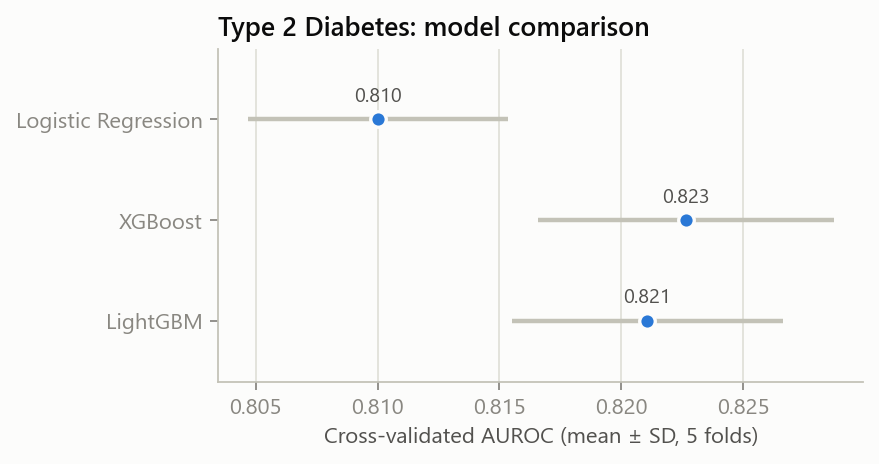
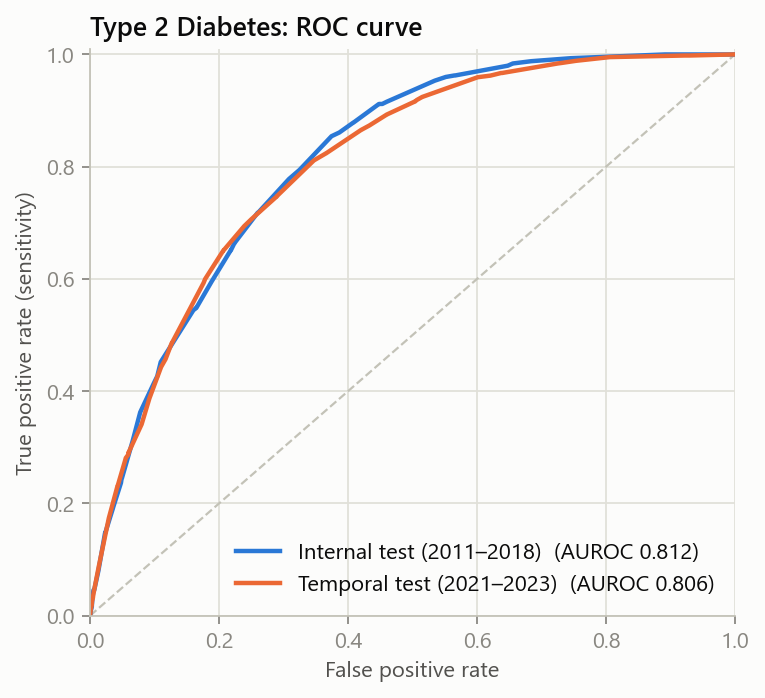
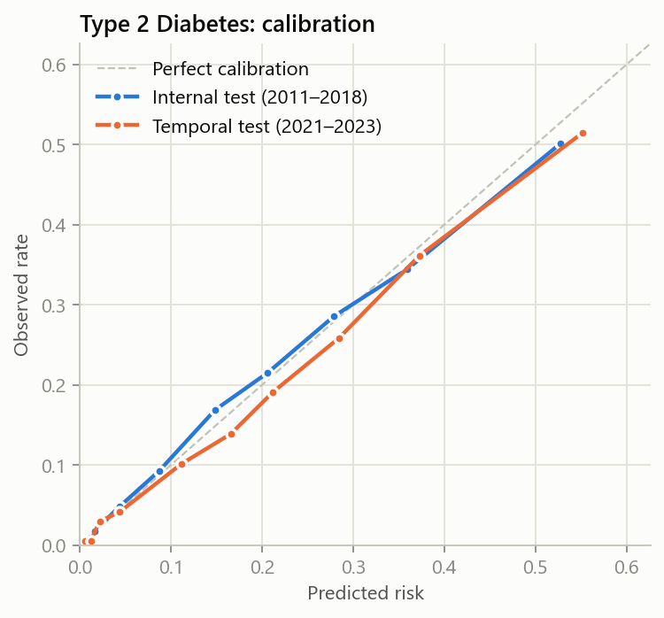
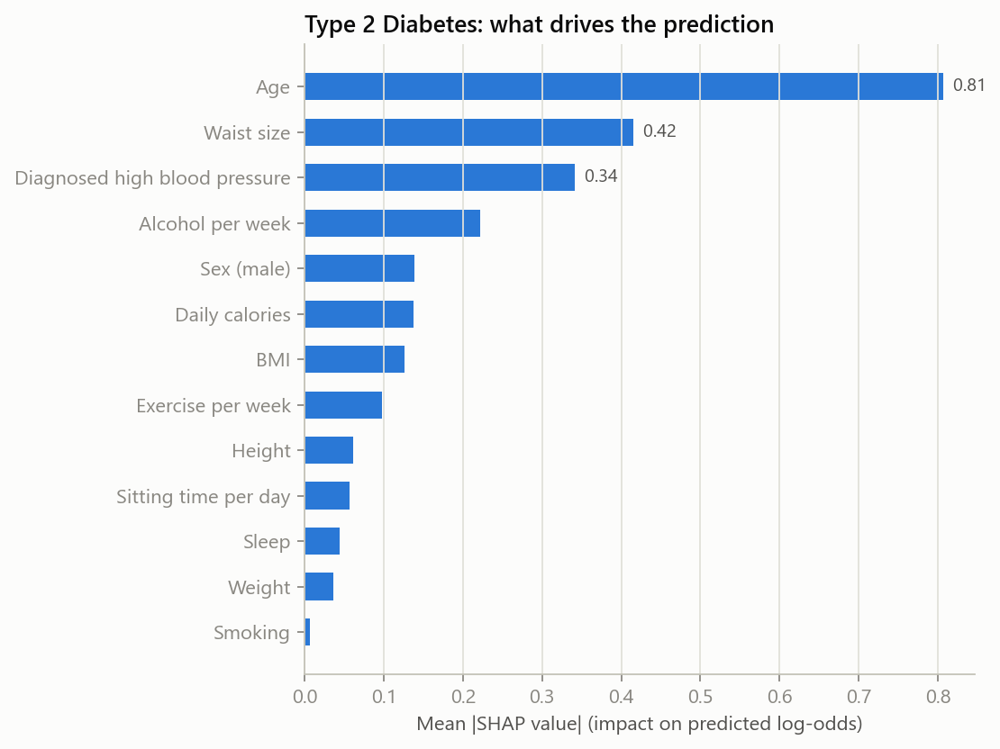
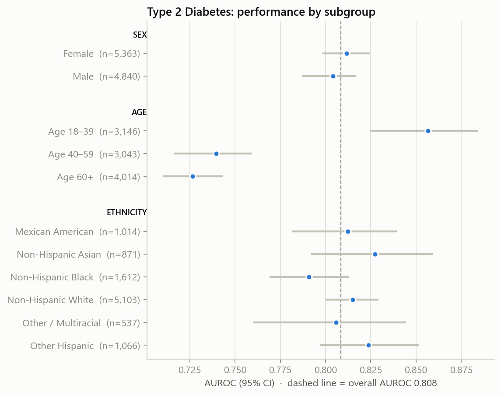

# Model card: Type 2 Diabetes risk (questionnaire)

**Predicts:** HbA1c ≥6.5%, diagnosed by a doctor, or taking insulin / diabetes pills (ADA criteria).

**Inputs:** age, sex, height, weight, BMI, waist (optional), exercise, sitting time, sleep, alcohol, smoking, daily calories (optional), and whether the person has diagnosed high blood pressure.
No lab tests are needed.

**Training data:** 17,065 US adults from NHANES 2011–2018 (17.5% prevalence). See [the dataset summary](../data/nhanes_dataset.md).

**Model:** XGBoost, picked from three candidates by 5-fold cross-validated AUROC. Probabilities are calibrated with isotonic regression on out-of-fold predictions.

## Model comparison

| Model | CV AUROC (mean ± SD) |
|---|---|
| Logistic Regression | 0.810 ± 0.005 |
| XGBoost ✅ | 0.823 ± 0.006 |
| LightGBM | 0.821 ± 0.006 |

## Performance

95% confidence intervals from 1,000 bootstrap resamples. The temporal test set (2021–2023) was collected after the training period and was never used for training or tuning.

| Metric | Internal test (2011–2018) | Temporal test (2021–2023) |
|---|---|---|
| People | 4,267 | 5,936 |
| Prevalence | 17.5% | 17.8% |
| AUROC | 0.812 (0.797–0.827) | 0.806 (0.793–0.819) |
| AUPRC | 0.432 (0.400–0.470) | 0.437 (0.408–0.466) |
| Brier score (lower is better) | 0.118 (0.112–0.124) | 0.120 (0.116–0.125) |
| Calibration error (ECE) | 0.013 (0.009–0.024) | 0.013 (0.010–0.025) |

**Screening threshold:** risk ≥ 18.2%, chosen on training data to catch at least 80% of cases.

| At the screening threshold | Internal test | Temporal test |
|---|---|---|
| Sensitivity (cases caught) | 79.4% (76.5–82.4) | 82.3% (79.9–84.5) |
| Specificity | 67.5% (65.9–69.1) | 63.5% (62.1–64.9) |
| PPV (flagged people who have it) | 34.2% (31.8–36.6) | 32.9% (31.0–34.8) |
| NPV (cleared people who don't) | 93.9% (93.0–94.9) | 94.3% (93.5–95.0) |
| People flagged | 40.7% | 44.7% |

 

## What drives the prediction (SHAP)

## Fairness audit

AUROC by subgroup on the combined internal and temporal test sets. Ethnicity is **not** a model input; it is used only for this audit.

AUROC *within* an age band is naturally lower than overall: age is the strongest predictor, and inside a narrow band it can no longer separate people. The useful fairness check is the comparison between sex and ethnicity groups, and whether mean predicted risk tracks the observed rate in each group (calibration).

| Group | Subgroup | n | AUROC (95% CI) | Observed rate | Mean predicted |
|---|---|---|---|---|---|
| Sex | Female | 5,363 | 0.812 (0.798–0.825) | 16.6% | 17.7% |
| Sex | Male | 4,840 | 0.804 (0.787–0.817) | 18.9% | 19.4% |
| Age | Age 18–39 | 3,146 | 0.857 (0.825–0.885) | 3.9% | 3.5% |
| Age | Age 40–59 | 3,043 | 0.739 (0.716–0.759) | 18.0% | 18.4% |
| Age | Age 60+ | 4,014 | 0.727 (0.710–0.743) | 28.4% | 30.3% |
| Ethnicity | Mexican American | 1,014 | 0.812 (0.782–0.840) | 20.7% | 16.6% |
| Ethnicity | Non-Hispanic Asian | 871 | 0.827 (0.792–0.859) | 16.1% | 13.3% |
| Ethnicity | Non-Hispanic Black | 1,612 | 0.791 (0.769–0.813) | 24.2% | 20.3% |
| Ethnicity | Non-Hispanic White | 5,103 | 0.815 (0.800–0.829) | 15.2% | 19.4% |
| Ethnicity | Other / Multiracial | 537 | 0.806 (0.760–0.845) | 19.4% | 18.0% |
| Ethnicity | Other Hispanic | 1,066 | 0.824 (0.797–0.852) | 17.4% | 18.0% |

**Calibration gaps (≥3 percentage points between observed and predicted):**

- The model under-estimates risk for **Mexican American** adults (observed 20.7%, predicted 16.6%).
- The model under-estimates risk for **Non-Hispanic Black** adults (observed 24.2%, predicted 20.3%).
- The model over-estimates risk for **Non-Hispanic White** adults (observed 15.2%, predicted 19.4%).

Ranking (AUROC) is similar across groups, but absolute risk is off for these groups. Possible fixes are group-specific recalibration or adding ethnicity as an input; both involve trade-offs and are left as future work.

## Limitations

- This is a screening estimate, not a diagnosis. Labels come from a single NHANES visit.
- It is trained on US adults; performance in other populations hasn't been validated.
- Lifestyle inputs are self-reported, so reporting errors reduce accuracy.
- It estimates whether the condition is present *now* (prevalence), not the risk of developing it in the future.
