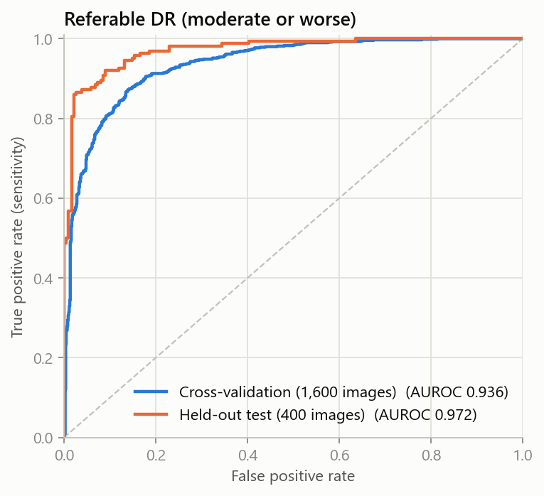
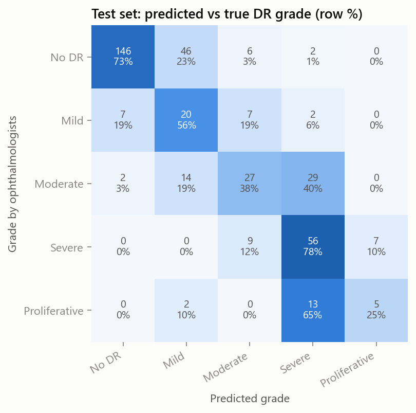
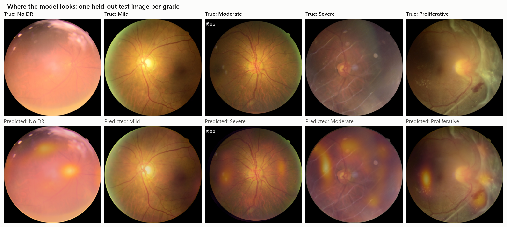

# Model card: Diabetic retinopathy (retina photo)

**Estimates:** the diabetic retinopathy (DR) grade from a colour fundus photo, on the 5-level international scale (No DR, Mild, Moderate, Severe NPDR, Proliferative DR), plus the probability of **referable DR** (moderate or worse, the level at which an eye specialist should see the patient) and of any DR.

**Training data:** [DeepDRiD](https://github.com/deepdrdoc/DeepDRiD) (Liu et al., *Patterns* 2022), the regular-fundus set: 2,000 images from 500 patients (2 eyes × 2 views each), graded by ophthalmologists. The official split is used: 1,600 images for development and 400 images from different patients as a held-out test set that was never used for training, tuning or model selection.

**Model:** EfficientNet-B0 (ImageNet-pretrained) fine-tuned as a regression on the grade at 384 × 384 px. Preprocessing crops the black border around the fundus and pads it to a square.
- Five models from 5-fold cross-validation (grouped by patient, stratified by grade) are averaged into one ONNX ensemble.
- Grade cut-points are tuned on the out-of-fold predictions to maximise quadratic weighted kappa.
- Probabilities come from logistic calibration on the out-of-fold predictions.
- At prediction time, the image and its two flips are averaged (test-time augmentation).
- The referable threshold is set for 90% sensitivity on the out-of-fold predictions.

Reproduce: `python -m ml.retina.train`, then `python -m ml.retina.export`, then `python -m ml.retina.report`.

## Performance

95% confidence intervals for the test set come from 1,000 bootstrap rounds that resample patients.

| Metric | Cross-validation (1,600 images) | Held-out test (400 images) |
|---|---|---|
| Quadratic weighted kappa (5 grades) | 0.785 | **0.852** (0.796–0.895) |
| Exact grade accuracy | 55.3% | 63.5% (56.3–70.8%) |
| AUROC, referable DR | 0.936 | **0.972** (0.947–0.988) |
| AUROC, any DR | 0.903 | 0.961 (0.929–0.983) |
| Sensitivity, referable DR | 90.0% | 92.1% (86.5–96.8%) |
| Specificity, referable DR | 82.3% | 89.0% (82.2–94.3%) |

The test scores are higher than cross-validation. Model choices were made on cross-validation only, so the gap is not tuning leakage. The likely reasons:
- The ensemble of five models is evaluated on the test set, while cross-validation scores single models.
- With 100 test patients, the confidence intervals are wide.

The cross-validation numbers are the conservative estimate.

The exported ONNX ensemble matches PyTorch (maximum score difference below 1e-5). The API's own code path, from raw image to response, reproduces the reported test predictions (r = 0.998).

 

Most errors are one grade away. The hardest boundaries are:
- Moderate vs Severe: 40% of moderate cases are predicted severe.
- Severe vs Proliferative: proliferative DR has only 20 test images.

Both errors stay on the referable side, so they do not change the "see an eye specialist" advice.

## What the model looks at

The class-activation map shows how much each region adds to the predicted grade. The app shows it with the result.

## Limitations

- **Small dataset:** 500 patients from one source in China, with no external validation yet.
- **Fundus camera only:** the model expects a fundus camera photo. Phone photos of the eye will not work; the API rejects images that do not look like a fundus.
- **Mild DR is hard to grade:** it is the least reliable grade, and the graders themselves disagree most there.
- **Not for diagnosis:** this is a screening aid, not a diagnosis. Anyone with diabetes should still have regular eye exams.
